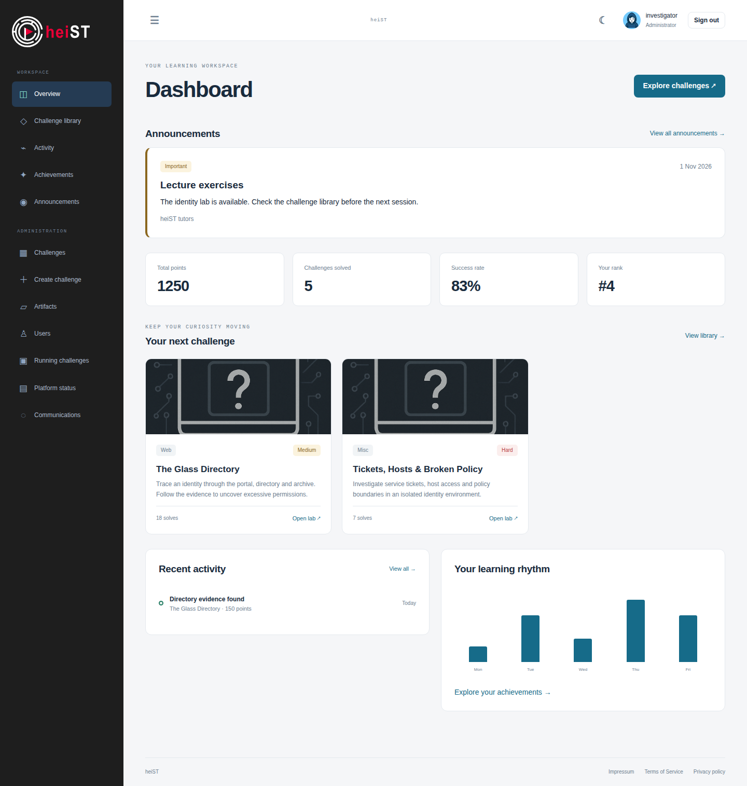
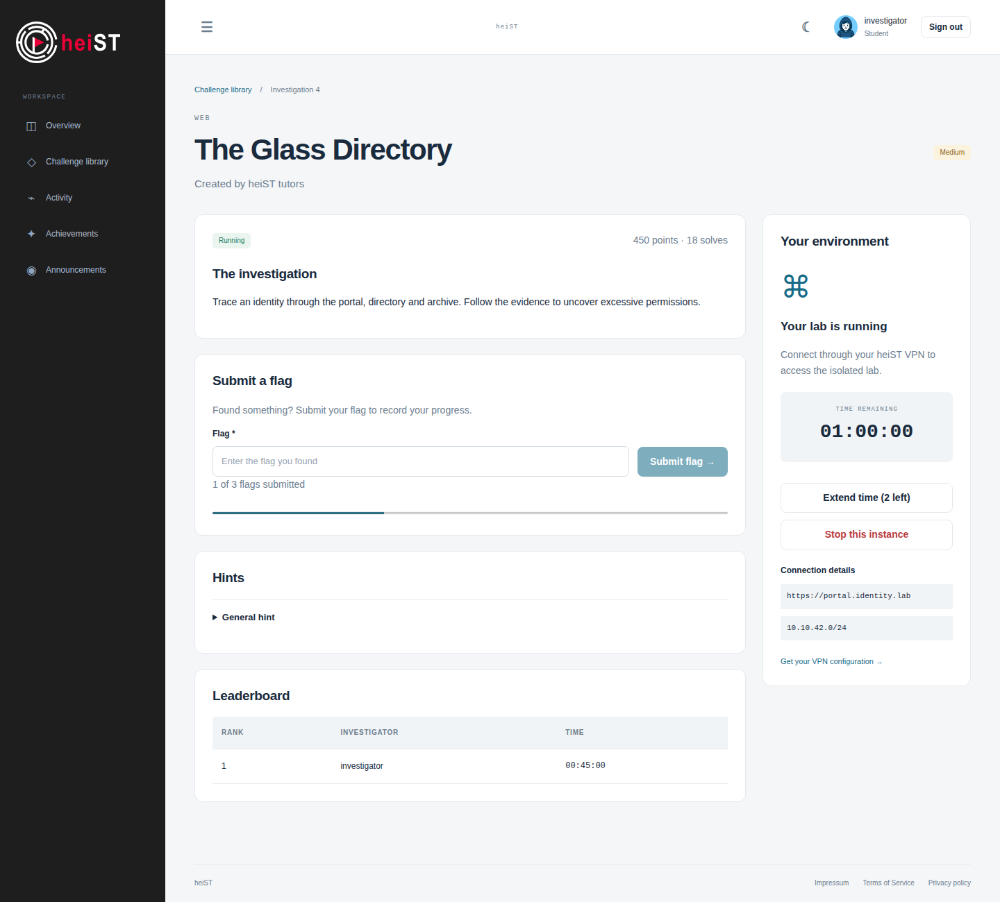
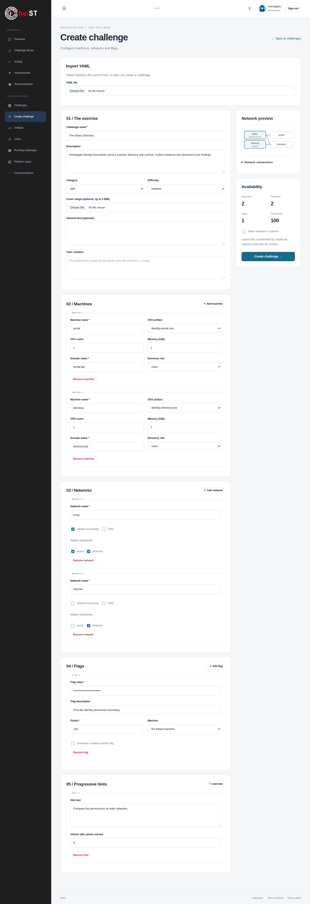
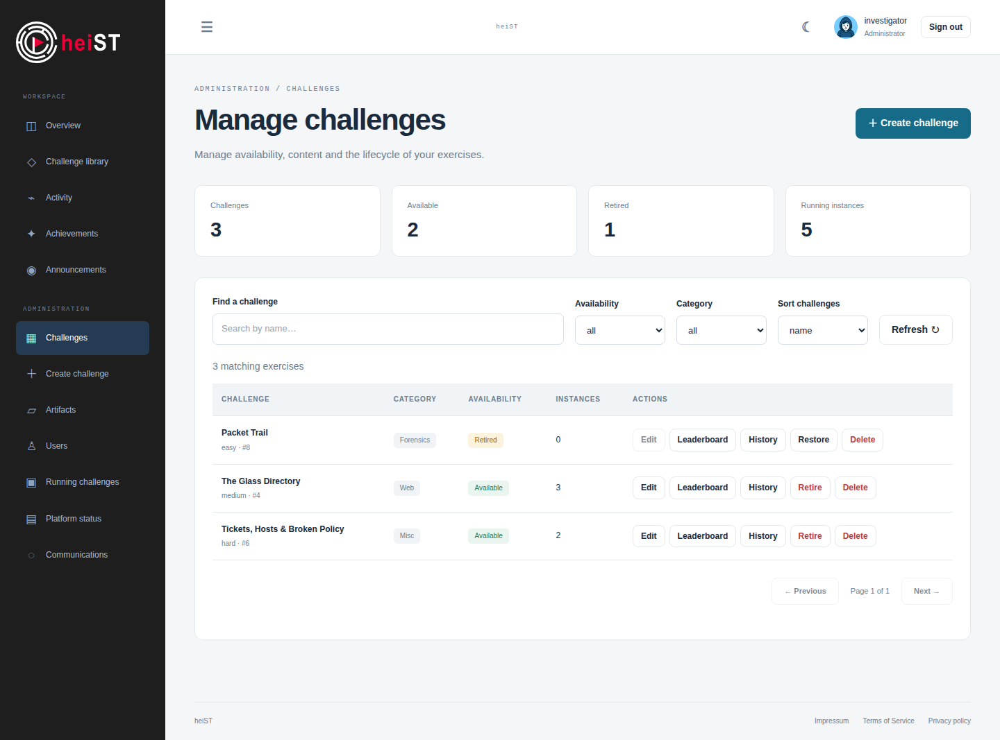
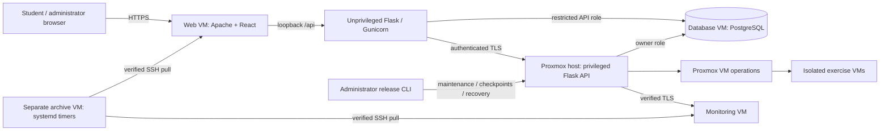

<!-- PROJECT SHIELDS -->

[![Contributors][contributors-shield]][contributors-url]
[![Forks][forks-shield]][forks-url]
[![Stargazers][stars-shield]][stars-url]
[![Issues][issues-shield]][issues-url]

<!-- PROJECT LOGO -->
 

  <picture>
    <source
      srcset="frontend/public/assets/logo/logo_dark.svg"
      media="(prefers-color-scheme: dark)"
      height="200"
    />
    
  </picture>

  <h3 align="center">Heidelberg Security Training - CTF-Challenges for everyone</h3>

  

    All-in-one security training platform for everyone, everywhere. Keep control over your training environment, learn
    by doing, and have fun while doing it.  
    <!-- TODO: ADD DOCUMENTATION
     
    <a href=""><strong>Explore the docs »</strong></a>
      -->
     
    <a href="https://github.com/EMCL-Research-ITSecLab/heiST/issues/new?template=bug_report.md">Report Bug</a>
    ·
    <a href="https://github.com/EMCL-Research-ITSecLab/heiST/issues/new?template=feature_request.md">Request Feature</a>
  

## Maintainer workflows

Use `bin/heist --help` for the explicit administrator and service commands.

- [Code layout and release maintenance](docs/development/README.md)
- [Local full-appliance testing](docs/testing/LOCAL-APPLIANCE.md)
- [Backend, API and web tests](docs/testing/README.md)
- [React UI development and static releases](docs/development/FRONTEND.md)
- [Operator helpers](docs/operator-tools/README.md)
- [Update wizard, migration and recovery](docs/administration/UPDATES.md)

## Getting Started

### Deployment status

This development branch uses React and Flask. Existing installations have a
checkpointed upgrade and recovery workflow; normal production admission requires
source-bound appliance acceptance. Clean-host installation is still disabled
pending its separate acceptance. See [updates and recovery](docs/administration/UPDATES.md),
[dated validation results](docs/validation/rollouts.md), and the
[isolated appliance workflow](docs/testing/LOCAL-APPLIANCE.md).

## Using the new workspace

[Browse all 52 full-page screenshots](assets/screenshots/README.md), including achievements, account pages and administrator controls. [Documentation index](docs/README.md).

The screenshots below show the actual production UI build with deterministic,
synthetic demonstration records. They are not screenshots of production data.
See [UI verification and screenshots](docs/testing/UI-VERIFICATION.md) for the test matrix,
full gallery and regeneration command.

### Student workspace

The overview shows progress, recent activity and the challenge library. Open an
investigation, connect using your personal VPN configuration and launch its lab.
The investigation page shows the remaining time, connection details, flag progress
and available hints. Stopping an instance requires confirmation.

<picture>
  <source srcset="assets/screenshots/dashboard_dark.png" media="(prefers-color-scheme: dark)" />
  
</picture>

<picture>
  <source srcset="assets/screenshots/deploy_challenge_dark.png" media="(prefers-color-scheme: dark)" />
  
</picture>

### Administrator console

Use **Artifacts** to upload an OVA. A sealed transfer is still under validation;
wait until it becomes available in the artifact library. In **Create challenge**,
define the machines, networks, flags and progressive hints. Keep the exercise
inactive while reviewing it, then publish it after import readiness is confirmed.

<picture>
  <source srcset="assets/screenshots/create_challenge_dark.png" media="(prefers-color-scheme: dark)" />
  
</picture>

**Challenges** provides search, category and availability filters, sorting and
pagination. Retiring an exercise prevents new allocations; restoring it requires
ready machine templates. Permanent deletion is a separate confirmed action.
**Lab overview** reports database, service, storage, lifecycle and archive status.
Administrators can manage user roles, temporary passwords and sessions, inspect
all running instances, release/rebuild/remove instances, and review the operation
registry. See the [administrator guide](docs/administration/README.md) for recovery
semantics and limits.

Production maintenance and rollback remain CLI operations.

<picture>
  <source srcset="assets/screenshots/manage_challenges_dark.png" media="(prefers-color-scheme: dark)" />
  
</picture>

## Platform Architecture
The target architecture separates the public browser API from privileged host
operations. Migration acceptance remains gated as described above.

The platform consists of four main components, the web application, the API, the database, and the monitoring system.
- The browser application uses React/TypeScript in [`frontend/`](frontend), served as static files by Apache. Its browser API is the unprivileged Flask service in [`heist/api/public/`](heist/api/public); privileged VM operations stay in the separate platform API. Deployment templates live under [`deploy/web/`](deploy/web). The dedicated web VM receives restricted database credentials and no Proxmox or SSH credentials. See [frontend development](docs/development/FRONTEND.md) and the current [migration gates](docs/development/ARCHITECTURE.md).
- The API is built using Python and the Flask framework, and is responsible for handling the core logic of the application, such as creating and managing virtual machines, and processing the uploaded files for challenge creation. The API interfaces with the Proxmox VE host using the Proxmox API, and with the database to store and retrieve information about the challenges, users, and other relevant data. The full implementation of the API can be found in the [`heist/api/`](heist/api) directory.
- The database is built using PostgreSQL, and is responsible for storing all the relevant data for the application, such as user information, challenge information, and other necessary data for the application to function properly. The database, including the schema and the necessary queries, is set up during the installation process, and can be found in the [`database/`](database) directory. For the same reasons as the web application, the database is also set up on a dedicated virtual machine to ensure isolation and security, and to allow for better resource management and scalability.
- The monitoring system is built using onto Grafana, bundling information gathered from various sources to monitor the health of the platform, and to provide insights into the usage of the platform. This includes monitoring the other components of the platform, such as the web application, the database, and the Proxmox VE host, as well as monitoring the deployed challenges, such as the status of the virtual machines and the commands executed by the users.
  In addition, the monitoring system also captures network traffic to allow for network forensics and analysis. The files needed to set up the monitoring system, including the configuration files for the various components, can be found in the [`heist/monitoring/`](heist/monitoring) directory. While the monitoring system is distributed across the Proxmox VE host, the other components of the platform, and the deployed challenges, there is a dedicated virtual machine that hosts the Grafana dashboard, and the wazuh manager, which collects the data from the other components and provides a central point for monitoring and analysis.

## Monitoring System Architecture

### Components
The monitoring system consists of the following components:
- **Grafana**: Grafana is used as the main dashboard for visualizing the collected data, and providing insights into the health and usage of the platform. It interfaces with the other components of the monitoring system to gather and display relevant information.
- **Prometheus**: Prometheus is used for collecting and storing metrics from the various components of the platform, such as the web application, the API, the database, and the Proxmox VE host. It provides a powerful query language to retrieve and analyze the collected metrics, which can then be visualized in Grafana.
- **Wazuh**: Wazuh is used for on-host monitoring of the virtual machines in the deployed challenges. It collects information about the processes running on the virtual machines, the commands executed by the users, and other relevant information for monitoring the challenges and providing insights into the users' interactions with the challenges.
- **Suricata**: Suricata is used for network monitoring and traffic analysis. It captures the network traffic to and from the deployed challenges, as well as between the core components of the platform and the internet. This allows for monitoring the network interactions of the users with the challenges, as well as monitoring the network traffic for potential security incidents and anomalies.
- **Zeek**: Zeek is used to parse the captured network traffic, and extract relevant information such as DNS queries, HTTP requests, and other relevant network interactions. This information is further analyzed to alert on potential security incidents, and to provide insights into the users' interactions with the challenges.
- **Vector**: Vector is used for log aggregation and processing. It collects logs from the various components of the platform, such as the web application, the API, the database, and the Proxmox VE host, as well as from Wazuh and Suricata. It processes and enriches the collected logs, and forwards them to Grafana for visualization and analysis.
   

<!-- CONTRIBUTING -->
## Contributing

Contributions are what make the open source community such an amazing place to learn, inspire, and create. Any
contributions you make are **greatly appreciated**.

If you have a suggestion that would make this better, please fork the repo and create a pull request. You can also
simply open an issue with the tag "enhancement".
Don't forget to give the project a star! Thanks again!

### Top contributors:

(<a href="#readme-top">back to top</a>)

<!-- LICENSE -->

## License

Distributed under the CC BY-NC 4.0 license. See [LICENSE.md](LICENSE.md) for more information.

(<a href="#readme-top">back to top</a>)

<!-- MARKDOWN LINKS & IMAGES -->
<!-- https://www.markdownguide.org/basic-syntax/#reference-style-links -->

[contributors-shield]: https://img.shields.io/github/contributors/EMCL-Research-ITSecLab/heiST.svg?style=for-the-badge

[contributors-url]: https://github.com/EMCL-Research-ITSecLab/heiST/graphs/contributors

[forks-shield]: https://img.shields.io/github/forks/EMCL-Research-ITSecLab/heiST.svg?style=for-the-badge

[forks-url]: https://github.com/EMCL-Research-ITSecLab/heiST/network/members

[stars-shield]: https://img.shields.io/github/stars/EMCL-Research-ITSecLab/heiST.svg?style=for-the-badge

[stars-url]: https://github.com/EMCL-Research-ITSecLab/heiST/stargazers

[issues-shield]: https://img.shields.io/github/issues/EMCL-Research-ITSecLab/heiST.svg?style=for-the-badge

[issues-url]: https://github.com/EMCL-Research-ITSecLab/heiST/issues

[license-shield]: https://img.shields.io/github/license/EMCL-Research-ITSecLab/heiST.svg?style=for-the-badge

[license-url]: https://github.com/EMCL-Research-ITSecLab/heiST/blob/master/LICENSE.md

[coverage-shield]: https://img.shields.io/codecov/c/github/EMCL-Research-ITSecLab/heiST?style=for-the-badge

[coverage-url]: https://app.codecov.io/github/EMCL-Research-ITSecLab/heiST
