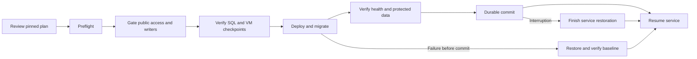

# Maintaining heiST

Use `bin/heist --help` for the explicit command registry. Service wrappers in
`bin/` remain stable; the installer no longer creates a command for every script
it discovers. Production updates use the release controller, separate from the
clean-host installer.

| Location | Responsibility |
|---|---|
| `heist/cli.py` | Explicit administrator/service command dispatch |
| `heist/config.py`, `files.py`, `remote.py` | Database settings, durable private files/locking, trusted SSH |
| `heist/rollout/` | Release plans, transaction/recovery policy, PVE and web adapters |
| `heist/maintenance/` | Verified SQL backups and explicit database restores |
| `heist/installer/` | Installer bootstrap, configuration interface and provisioning |
| `heist/backend/` | API and challenge lifecycle services; compatibility entry points |
| `heist/monitoring/` | Monitoring provisioning and packaged resources |
| `frontend/` | React UI source, themes and browser API client |
| `webserver/` | PHP web API, Apache configuration and UI entry shell |
| `tools/challenges/`, `tools/images/`, `tools/maintenance/` | Explicit operator helpers, separate from runtime packages |
| `releases/` | Versioned manifests and immutable SQL migrations |
| `tools/local/` | Workstation appliance lifecycle and explicit disposable rehearsals |
| `tests/` | Portable regressions and explicitly enabled infrastructure checks |

Keep generated metadata, environments, credentials, VM disks and release bundles
outside Git. Keep private appliance data under one external build root such as
`/mnt/data/heist-builds`. See [local testing](LOCAL-APPLIANCE.md),
[test commands](TESTING.md) and [updates/recovery](UPDATES.md).

## Preparing a release

1. Start from a reviewed source commit. Keep the version in `pyproject.toml` and
   its `releases/*.json` manifest consistent.
2. Declare exact supported starting commits. Declare ordered migration IDs/paths
   and SHA256 digests; never edit a migration already applied elsewhere.
3. Keep student/account/grade tables in the protected-data declaration. Add an
   explicit reviewed adapter for dependency or infrastructure changes that the
   current protocol refuses.
4. Run portable/API, disposable PostgreSQL and private frontend tests. Rehearse
   update, failure recovery, deliberate rollback and restart behavior against an
   isolated restored production clone. Retain the exact commit and evidence.
5. During scheduled maintenance, apply the reviewed immutable plan using a
   separate release-runner checkout. Keep the original checkpoint and the newer
   safety checkpoint required by the rollback policy.

The fresh installer changes the host and is not an update command. For a local
installation rehearsal, take a stopped standalone appliance checkpoint first;
restore by cloning that checkpoint into a new work directory. Physical host
OS/network recovery needs its own tested backup/console procedure.

See [frontend development and release artifacts](FRONTEND.md) and the
[operator tools](operator-tools/README.md). All current development is consolidated
on `dev`; the earlier feature branches are already ancestors of that branch.

Private settings belong in `config/installer.env` and `config/backend.env`.
Existing installations may retain their original private paths: the environment
loader reads them in place and translates packaged resource paths without
copying credentials or moving private keys.
